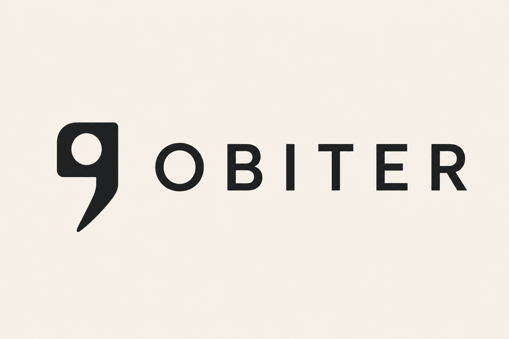

  <picture>
    <source media="(prefers-color-scheme: dark)" srcset="./docs/brand/obiter-lockup-dark.png">
    
  </picture>

  Legal intelligence infrastructure for source-grounded research, verification, redaction, legal source handling, and matter workspaces.

---

Obiter is a product platform for legal work where evidence, confidentiality, and reviewability matter. It is not a chatbot wrapper; it is a legal infrastructure layer for working with public sources, private matter material, verification evidence, and responsible AI-assisted workflows.

This repository is the product monorepo for the Obiter web app, the desktop app and the packages they share.

The server side — the API, legal ingestion, search, Verify, and the database migrations — lives in the separate private [`ObiterDictum/backend`](https://github.com/ObiterDictum/backend) repository, which includes this one as an `obiter/` submodule. Find Case Law material is licensed and must not be published, so everything that reads, indexes or verifies case law is kept there. See [docs/backend-repo-split.md](docs/backend-repo-split.md) for why the line is drawn there.

## Product

Obiter is being built around a small set of durable legal workflows:

- **Search**: source-grounded search across stored legal-source records, with Find Case Law ingestion for UK judgments performed only by an explicit indexing run.
- **Matters**: private workspaces for legal documents, matter context, review state, deadlines, and generated artifacts.
- **Redaction**: reviewable and auditable protection of sensitive material before documents enter AI-assisted workflows.
- **Verification**: citation, quotation, and proposition checking against source evidence.
- **Research**: source-bound legal analysis with visible support and uncertainty.
- **Evaluation**: repeatable measurement of legal AI behavior, retrieval quality, and verification performance.

The current product slice is concentrated on Search, stored case pages, the authenticated workspace shell, matter scaffolding, and the API/storage boundaries that later private workflows will rely on.

## Principles

- Legal work should remain inspectable and attributable.
- Private matter data is sensitive by default.
- Search, verification, redaction, and research should be built on explicit source boundaries.
- Generated artifacts, document versions, audit records, prompts, embeddings, and logs must not blur public-source and private-matter data.
- Legal-critical failures should be visible rather than hidden behind quiet fallbacks.

## System

- `apps/web`: browser app.
- `apps/desktop`: Electron desktop app.
- `packages/app-shell`: shared app shell, sidebar, route views, Search UI, and case views.
- `packages/contracts`: shared API and product contracts, read by the API in `backend`.
- `packages/ui`: shared UI primitives and design tokens.
- `packages/redact-ui`: redaction review and finalize UI.
- `packages/redaction-policy`, `packages/ooxml`: shared domain packages for redaction and DOCX.
- `packages/rampart-inference`: the vendored detection model, consumed by the backend API.
- `services/redaction-renderer`: sandboxed DOCX-to-PDF rendering worker.
- `docs`: product, architecture, compliance, roadmap, and implementation notes.
- `infra`: deployment and operations placeholders.
- `data`: seed, fixtures, and evaluation placeholders.

The API (`services/api`), the ingestor (`services/legal-ingestor`), the case-law packages (`legal-schema`, `legal-source-provider`, `search-client`, `verification-core`) and the migrations (`packages/database`) are not in this repository. Run them from a `backend` checkout.

## Current Search Surface

Search is the most developed product slice:

- `/search` provides the shared Search UI.
- `/cases/:caseId` opens stored judgment pages.

`POST /api/search/fetch` and `GET /api/search/documents/:documentId` are served by the API in `backend`; the request and response shapes the clients read stay here in `packages/contracts`. PostgreSQL is the source of record for legal-source metadata and stored documents, and Meilisearch is a derived index for lexical retrieval. The user-facing API is corpus-only: it never contacts Find Case Law, and a miss answers honestly under the stored-only contract. National Archives calls happen only during an explicit indexing run in `backend`, in `services/legal-ingestor`.

## Working In The Repo

Engineering workflow, commands, review expectations, and test guidance live in:

- [AGENTS.md](AGENTS.md)
- [RULES.md](RULES.md)
- [PR.md](PR.md)
- [TESTING.md](TESTING.md)

### Development data

Obiter has no seed script. To get an organisation, user, matters, and documents in any environment (including development), use the real self-serve flow:

1. Start the API from a `backend` checkout (`bun run dev:api` there; see that repository's README for `.env` and the Docker services). It applies the migrations in `packages/database/migrations` at startup; to apply them separately, run `bun run db:migrate --database-url=<url>` in the same checkout.
2. Start the web app here with `OBITER_API_ORIGIN` pointing at that API (`bun run dev:web`, or `bun run dev:desktop` for the desktop shell).
3. Open the app and register an account through the sign-up screen. Registration provisions your organisation automatically.
4. Verify the email (in development the one-time verification URL is logged to the API console when no Resend key is configured).
5. Sign in, then create matters and upload document metadata through the UI.

### Redaction model

Redaction detection runs a local ONNX model that is downloaded from Hugging Face on first use and cached in `~/.cache/obiter/rampart-models` (`%LOCALAPPDATA%\Obiter\rampart-models` on Windows). The API fetches it at startup and logs whether it is ready; `bun run prefetch:rampart` in a `backend` checkout does the same without booting the API, which is worth running after a clone or an install on a slow connection.

Without the model, redaction still runs but only with the deterministic heuristics, and the review UI marks those runs as limited detection. If you see that, check the API startup log for the load failure.

The ONNX Runtime install is CPU-only. `onnxruntime-node`'s postinstall would otherwise download the optional CUDA and TensorRT execution providers (~343 MB unpacked) on Linux x64, and no Obiter surface uses them: detection runs with `device: 'cpu'`, the browser path uses onnxruntime-web, and the desktop bundle excludes `node_modules`. Bun never runs that postinstall here: Bun executes a dependency's lifecycle scripts only for trusted dependencies, `onnxruntime-node` is not in Bun's default-trusted set, and no workspace trusts it — a backend test pins all three. To run detection on a GPU, opt in explicitly with `ONNXRUNTIME_NODE_INSTALL_CUDA=v12 bun pm trust onnxruntime-node`, which adds the package to `trustedDependencies` and runs the script immediately. Returning to CPU-only is the inverse: delete the `onnxruntime-node` entry from `trustedDependencies` in `package.json`, then `rm -rf node_modules && bun install --frozen-lockfile` for a fresh tree with no provider payload.

Useful product context:

- [Current Product Scope](docs/current-product-scope.md)
- [Product Thesis](docs/product-thesis.md)
- [Architecture](docs/architecture.md)
- [Data and Compliance](docs/data-and-compliance.md)
- [Roadmap](docs/roadmap.md)
- [Specs](docs/specs/README.md)

Package scopes still use `@obiter/*` while the product rename is in progress.

## License

Obiter is licensed under the [Elastic License 2.0](LICENSE).

You can inspect the source, fork it, run it yourself, adapt it for your own organisation, and contribute improvements back.

You cannot provide Obiter itself to third parties as a hosted or managed service, or sell managed Obiter hosting, without a separate commercial agreement.

Public legal source data is governed by the relevant upstream terms. The current UK case law path uses Find Case Law data from The National Archives, including the Open Justice Licence constraints and any separate computational-analysis licensing requirements.
